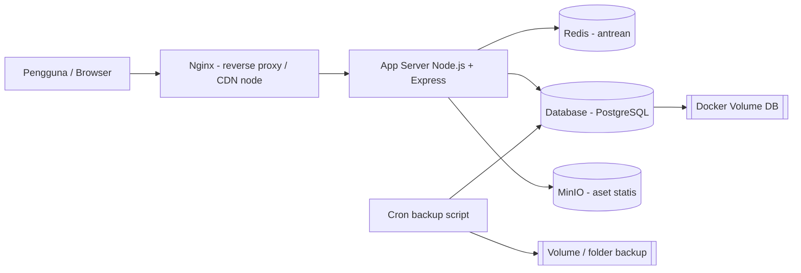
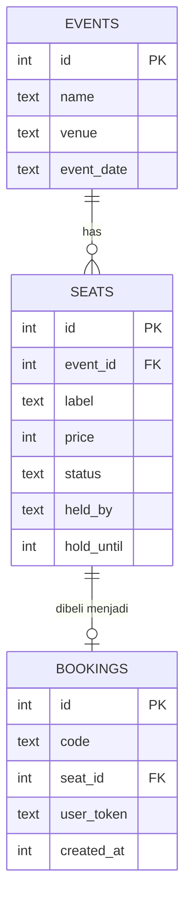

# Dokumen Spesifikasi Arsitektur
**Studi Kasus:** Platform Booking Tiket Konser (Ticketing) — Kelompok 3
**Anggota:** Davin, Ali, M. Cavin, Alif

## 1. Latar Belakang & Tantangan
Saat *war* tiket, ribuan pengguna mengakses sistem bersamaan dalam hitungan detik (*spike*). Risiko utama:
1. Server kewalahan karena lonjakan akses.
2. **Double booking**: dua pengguna mendapat kursi yang sama.
3. Kursi yang sedang di-*hold* (dipesan, belum dibayar) hilang atau direbut pengguna lain saat terjadi kegagalan sistem.

## 2. Kebutuhan
**Fungsional:** antrean (waiting room), lihat denah kursi, *hold* kursi sementara, pembayaran (simulasi), kode booking.
**Non-fungsional:** konsistensi kursi (tidak ada double booking), ketersediaan tinggi saat spike, pemulihan cepat dari kegagalan (lihat DRP), data persisten.

## 3. Arsitektur Target (dicapai bertahap sampai Pertemuan 5)

| Pertemuan | Wujud arsitektur |
|---|---|
| 1 (sekarang) | Monolit Node.js + SQLite, antrean in-memory, berjalan di localhost |
| 2 | Docker: App + PostgreSQL + Redis, Docker Volume |
| 3 | Stress test 10 → 1000 VU, analisis bottleneck |
| 4 | Backup otomatis + DR Test |
| 5 | Nginx/MinIO sebagai CDN node untuk aset statis |

## 4. Komponen
| Komponen | Teknologi | Peran |
|---|---|---|
| Frontend | HTML + JS ringan | Antrean, denah kursi, hold, bayar |
| Backend/API | Node.js + Express | Logika bisnis, validasi |
| Queue Service | In-memory (P1) → Redis (P2) | Waiting room: membatasi jumlah pengguna aktif |
| Database | SQLite (P1) → PostgreSQL (P2) | **Sumber kebenaran** status kursi & booking |
| Backup | Bash + cron | Dump database berkala |

**Keputusan desain penting:** status *hold* kursi disimpan di **database** (kolom `held_by`, `hold_until`), bukan hanya di Redis. Redis hanya untuk antrean. Dengan begitu, jika Redis crash, kursi yang sudah di-hold tetap konsisten.

## 5. Model Data

Status kursi: `available → held → sold` (hold otomatis kedaluwarsa setelah 300 detik).
Constraint: `UNIQUE(event_id,label)` pada seats dan `UNIQUE(seat_id)` pada bookings sebagai pengaman terakhir terhadap double booking.

## 6. Alur Booking
1. Pengguna `POST /api/queue/join` → mendapat token dan posisi antrean.
2. Server memasukkan N pengguna per interval (default 5 tiap 2 detik).
3. Pengguna yang sudah masuk melihat denah dan `POST /api/seats/:id/hold` (maks. 4 kursi).
4. Hold memakai **UPDATE kondisional atomik** (`WHERE status='available' OR hold kedaluwarsa`); hanya satu pengguna yang menghasilkan `changes = 1`.
5. `POST /api/bookings/pay` dalam satu transaksi: kursi hold milik token → `sold` dan dibuat kode booking.

## 7. Spesifikasi API
| Method | Endpoint | Keterangan |
|---|---|---|
| GET | `/health` | Cek aplikasi + database |
| POST | `/api/queue/join` | Masuk antrean, mengembalikan token |
| GET | `/api/queue/status/:token` | Posisi antrean / status admitted |
| GET | `/api/events/:id/seats` | Denah kursi + status |
| POST | `/api/seats/:id/hold` | Hold kursi (header `x-queue-token`) |
| POST | `/api/seats/:id/release` | Lepas hold |
| POST | `/api/bookings/pay` | Bayar (simulasi) semua kursi hold |

## 8. Risiko Arsitektur & Mitigasi
| Risiko | Mitigasi |
|---|---|
| Spike traffic | Waiting room, nanti diukur dengan stress test (P3) |
| Double booking | UPDATE atomik + constraint UNIQUE + transaksi |
| Redis/DB crash | Hold di DB, backup berkala, prosedur recovery (DRP) |
| Single point of failure | Dicatat sebagai keterbatasan; dievaluasi setelah stress test |
